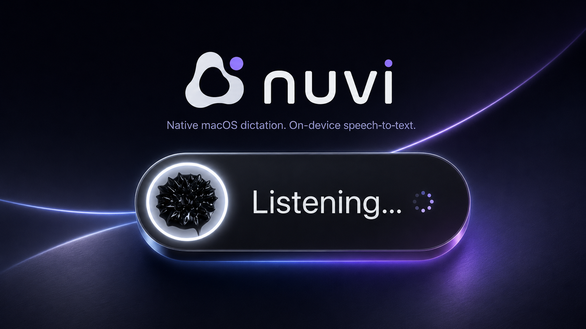
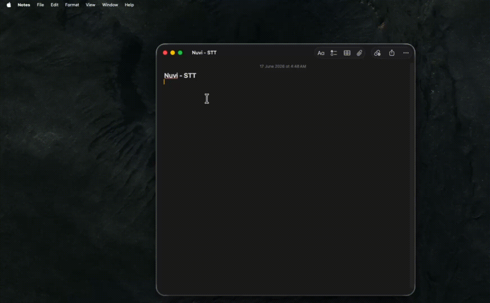

# Nuvi

<p align="center">
  
</p>

**Speak. Release the shortcut. Keep writing.**

Nuvi lives in your Mac's menu bar and turns speech into text at the cursor. Hold a
push-to-talk shortcut or toggle dictation, watch the floating ferrofluid pill, and
continue in the app you were already using.

Native Swift, AppKit, SwiftUI and Metal — no Electron or Python runtime.

[Install](#install) · [First dictation](#first-dictation) · [Models & privacy](#models--privacy) · [Development](docs/development.md) · [Release notes](docs/releases/)

## Install

**Requires macOS 26 or later and Apple Silicon.**

```bash
brew tap ForLess01/tap
brew install --cask nuvi
```

> [!IMPORTANT]
> The documented Homebrew distribution is **not notarized**. macOS may block
> first launch. Review the source and release you are installing before allowing
> it through macOS Privacy & Security; do not disable Gatekeeper globally.

Models are downloaded separately when needed. Allow time and an internet
connection for the selected engine's initial setup; the app download does not
include speech models. Prefer a source build? See [development](docs/development.md).

## Made for dictation on your Mac

| Feature | What it does |
| --- | --- |
| **Toggle or push to talk** | Dictate hands-free, or hold a shortcut and release to finish. |
| **Native audio ducking** | Optionally lower other audio while recording; enabled by default. |
| **On-device engines** | Choose Apple SpeechAnalyzer, WhisperKit or Parakeet in the Models Library. |
| **A visible—or quiet—interface** | Ferrofluid pill and menu-bar status, with independent visibility controls. |
| **LIVE & translation · Beta** | Insert text progressively or translate output with Apple's Translation framework. |
| **Your writing workflow** | Recent transcriptions, vocabulary replacements and modes for formatting or app-specific preferences. |

<details>
<summary><strong>Watch Nuvi in action</strong></summary>

<p align="center">
  
</p>

The [v2.1 menu-bar recording](docs/assets/releases/v2.1.0/menubar-status.gif)
shows the earlier status presentation; current UI details may differ.

</details>

## First dictation

1. Open Nuvi and find its menu-bar icon; it does not use a Dock window.
2. Allow **Microphone**, **Speech Recognition** for Apple's engine, and
   **Accessibility** for insertion into other apps. Finish any requested model setup.
3. Focus an editable field, press **⌥ Space**, speak, then press it again to finish.
   Prefer hold-to-record? Set a push-to-talk shortcut in Settings.

| Shortcut | Action |
| --- | --- |
| **⌥ Space** | Toggle dictation |
| **Your push-to-talk shortcut** | Hold to record, release to finish |
| **⌥⇧K** | Cycle mode |
| **Esc** | Cancel recording |

Shortcuts are customizable in **Settings → Configuration → Keyboard Shortcuts**.
The interface supports English and Spanish.

<details>
<summary><strong>Permissions & insertion troubleshooting</strong></summary>

Open **System Settings → Privacy & Security** to review Nuvi's access:

| Permission | Used for |
| --- | --- |
| Microphone | Recording your voice |
| Speech Recognition | Authorizing Apple's speech engine |
| Accessibility | Inserting text into the focused application |

Without Accessibility access, completed dictation can fall back to the clipboard
for manual pasting. The pill distinguishes **Inserted** from **Copied** without
showing the transcript. LIVE insertion is Beta: unsupported or secure fields
fail closed rather than forcing text into them.

After rebuilding from source, a changed signing identity can affect permissions.
See the [signing notes](docs/development.md#signing--local-installation).

</details>

## Models & privacy

Transcription runs on-device. **On-device does not mean network-free setup:**
model downloads, translation language assets and update checks may need a connection.
Offline dictation depends on having compatible assets installed for your chosen
engine and language.

<details>
<summary><strong>Choose an engine</strong></summary>

| Preference | Implementation | Notes |
| --- | --- | --- |
| **SpeechAnalyzer** · default | Apple's `SpeechAnalyzer` and `SpeechTranscriber` | Language availability depends on supported locales and installed Apple speech assets. |
| **Auto** | SpeechAnalyzer with WhisperKit fallback | May need assets for either engine. |
| **WhisperKit** | Whisper models through CoreML | Select and manage models in the Models Library. |
| **Parakeet** | NVIDIA Parakeet TDT through FluidAudio | Activating a Parakeet model selects this engine. |

Engine and model changes apply to the next dictation. An active recording keeps
its original configuration. Model sizes and memory figures in the library are
guidance, not a performance guarantee; this repository does not provide a
comparative speed or accuracy benchmark.

</details>

<details>
<summary><strong>History, translation & network activity</strong></summary>

- **History is enabled by default.** Recent Transcriptions lets you recover, copy
  or insert results. History controls let you opt out of storing new dictation.
  The standard bundle stores its local history at
  `~/Library/Application Support/com.nuvi.app/history.json`.
- **Translation is optional and Beta.** Output can remain in the original
  language or target English (US), English (UK) or Portuguese (Brazil).
  Supported pairs and downloaded language assets depend on Apple's framework.
- **Models are local after download.** Availability and preparation differ by
  engine; selecting a model is not proof that it is ready for offline use.
- **Update notices contact GitHub for release metadata**, not your recordings
  or transcriptions. They do not download or install an update.

</details>

<details>
<summary><strong>Update Nuvi</strong></summary>

Nuvi checks for stable releases on startup and every 12 hours, with throttling
across restarts. **Settings → Configuration → Updates** shows the installed and
available versions, last check and manual refresh. Notifications are optional;
the Settings notice remains available if macOS blocks alerts.

To upgrade a Homebrew installation:

```bash
brew update
brew upgrade --cask nuvi
```

</details>

## Project guide

| Looking for… | Start here |
| --- | --- |
| Building, architecture, tests and engine probes | [Development guide](docs/development.md) |
| Packaging, signing and release checklist | [Maintainer release guide](docs/releasing.md) |
| Version-specific changes | [Release notes](docs/releases/) |
| Artwork and documentation media | [Asset guide](docs/assets/README.md) |

LIVE insertion, translation and native audio behavior need testing on real Macs
and in real target apps. See [verification boundaries](docs/development.md#verification-boundaries)
for the difference between automated checks and hardware acceptance.
